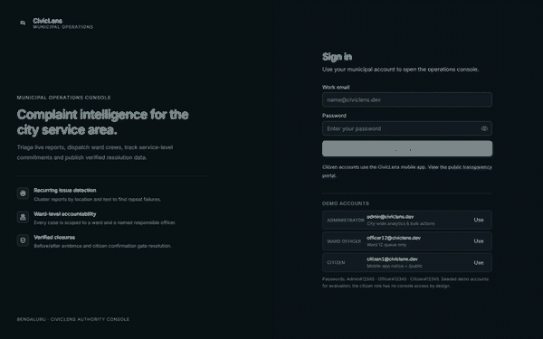
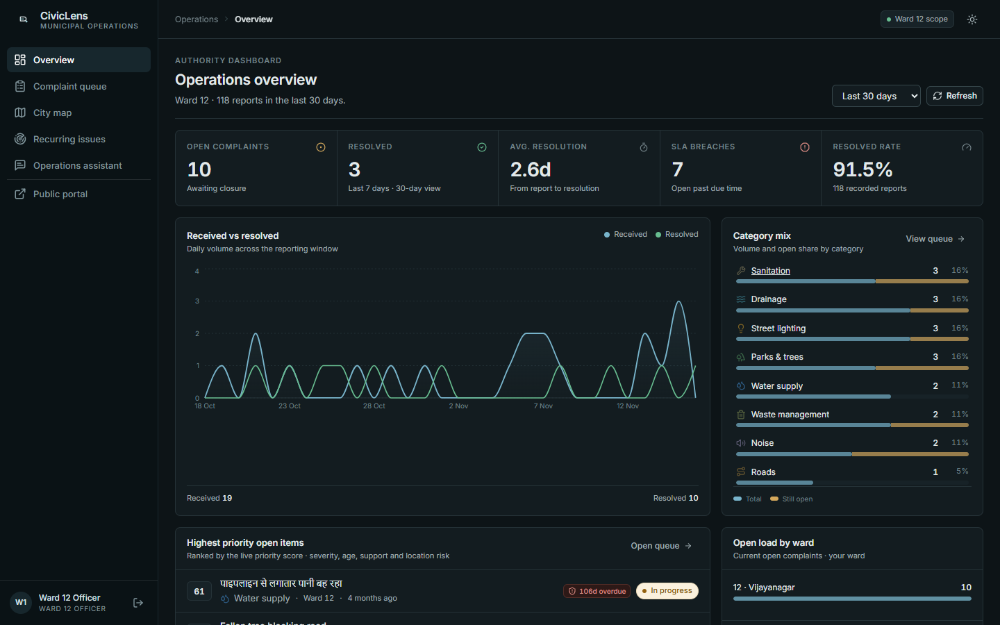
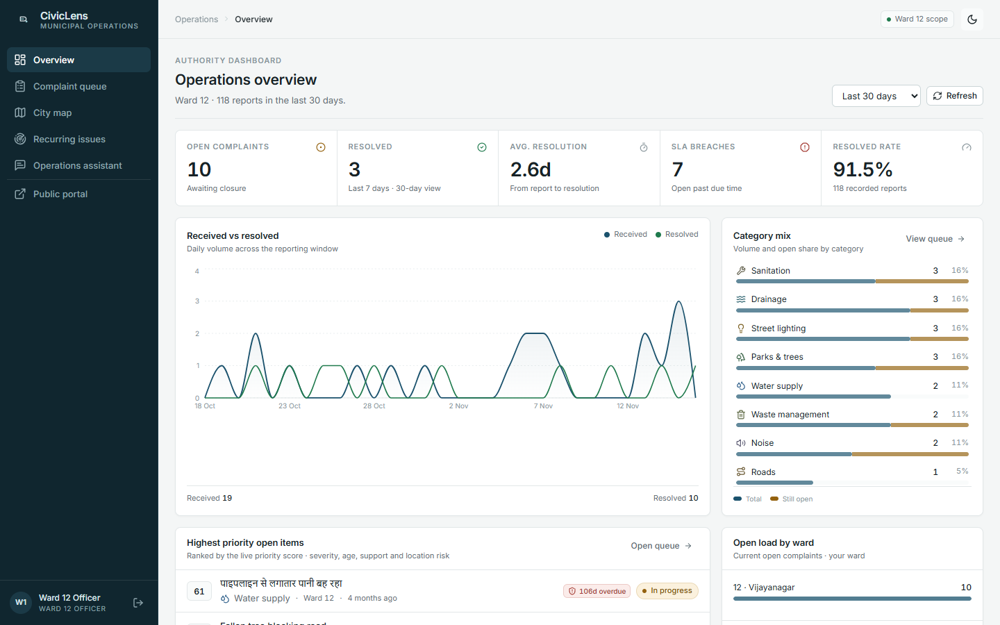
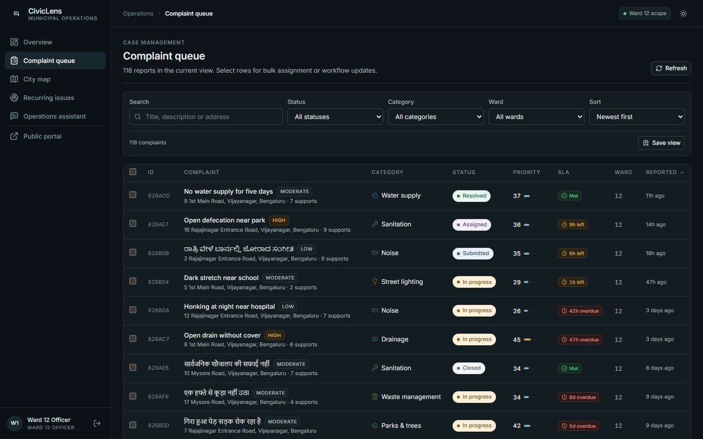
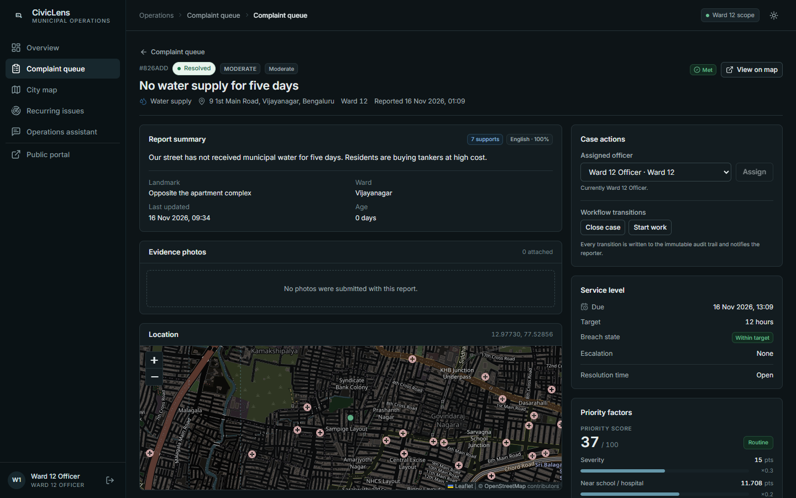
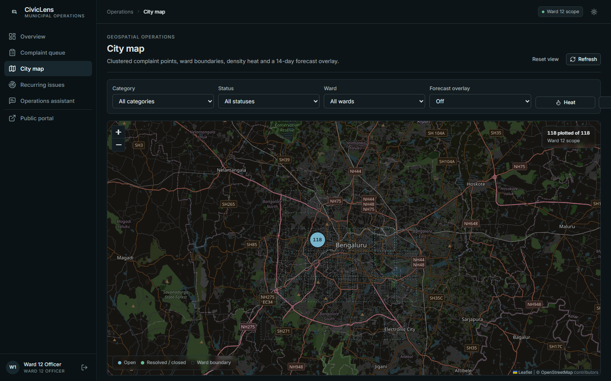
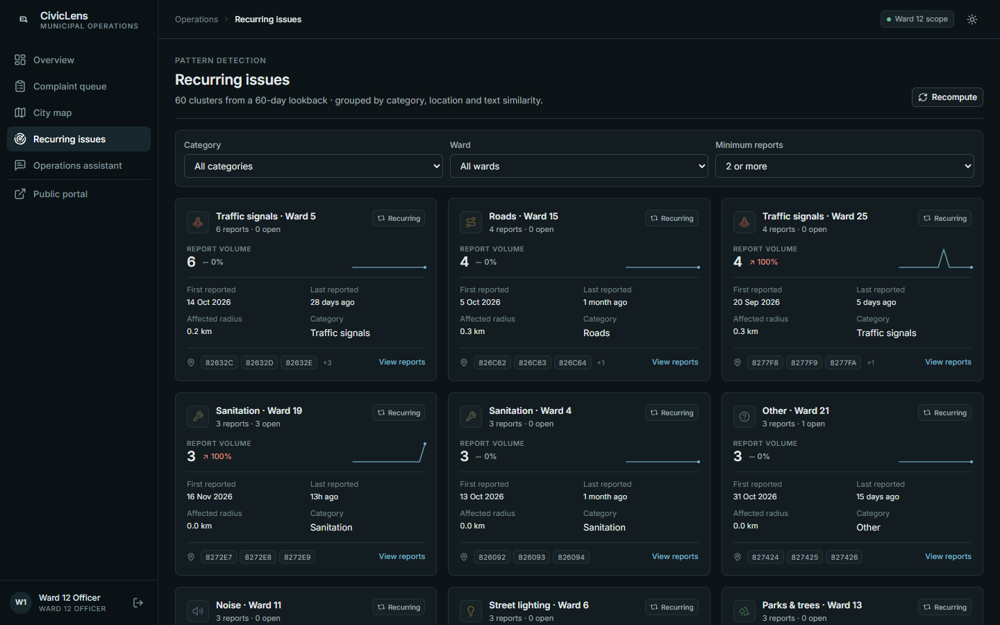
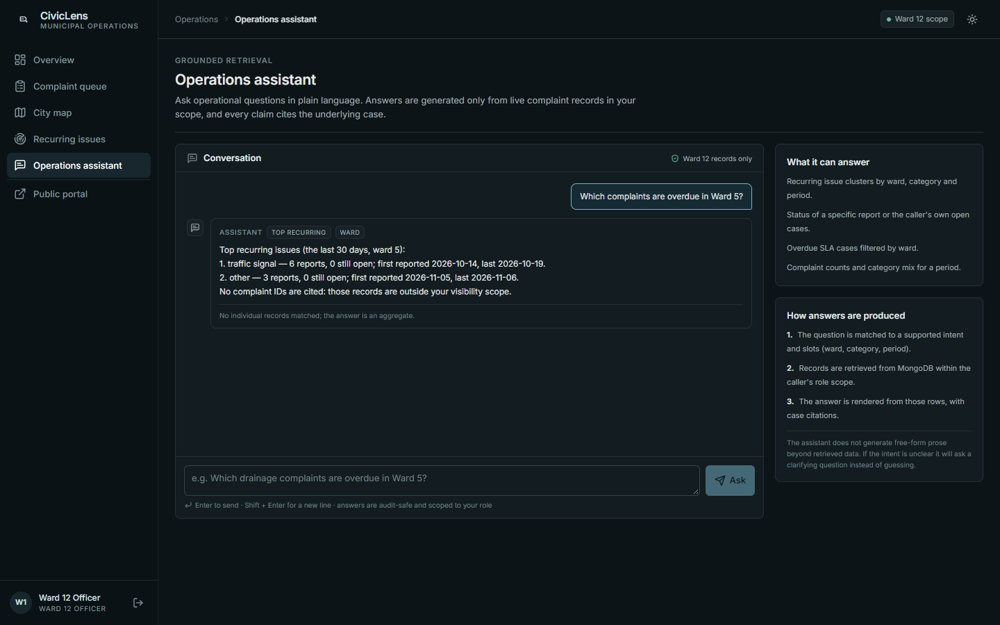
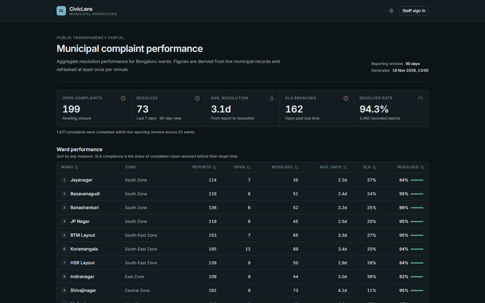
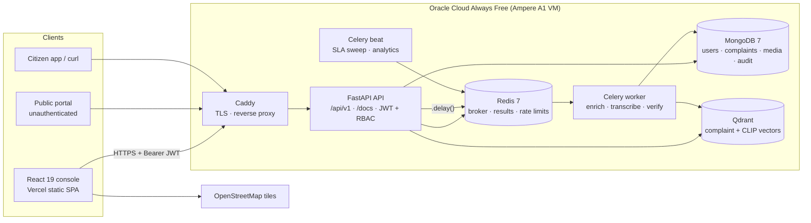

# CivicLens AI

[](https://github.com/nithyaa021/civiclens/actions/workflows/ci.yml)

**Civic complaints become a ranked, verifiable repair queue — multilingual
intake, duplicate detection, SLA enforcement and photo-verified closure in one
municipal platform.**

Citizens report potholes, garbage, broken streetlights, water leakage, drainage,
encroachment and stray animals in English, Hindi or Kannada (text or voice). The
service resolves the ward, finds nearby duplicate reports, assigns the
responsible officer, starts an SLA clock, scores priority from a transparent
weighted breakdown, clusters recurring issues, verifies before/after photo
evidence and forecasts hotspot volume. A role-scoped assistant answers questions
and always cites real complaint IDs.

> **Status:** Phases 1-4 are complete and verified end-to-end (108 backend
> tests, 11 frontend tests, real worker/broker smoke run). Phase 5 ships the
> Oracle Always Free + Vercel deployment, GitHub Actions pipeline, demo assets
> and the documentation below. Every AI number in this README was measured on the
> deterministic, labelled corpus in `backend/app/data/corpus.py` by
> `backend/scripts/evaluate.py` — no hand-written or mocked metrics.



*28-second walkthrough: sign in, ward-scoped overview, complaint queue, case
detail with verification evidence, city map and the public transparency portal.*

---

## Live demo

The production topology runs the complete stack on one Oracle Cloud Always Free
Ampere A1 VM: Caddy, FastAPI, Celery worker/beat, MongoDB, Redis and Qdrant, deployed by
[`deploy/oracle/docker-compose.prod.yml`](deploy/oracle/docker-compose.prod.yml).
The static React console is on Vercel Hobby. No managed database, card charge or
paid service is involved; see [`docs/DEPLOY.md`](docs/DEPLOY.md) for the full
runbook.

| Surface | URL |
|---|---|
| Source (GitHub) | https://github.com/nithyaa021/civiclens |
| Staff console (Vercel) | `https://<vercel-project>.vercel.app` |
| Public transparency portal | `https://<vercel-project>.vercel.app/public` |
| API reference (Swagger UI) | `https://api.<public-ip>.sslip.io/docs` |
| OpenAPI schema | `https://api.<public-ip>.sslip.io/openapi.json` |

The two placeholder rows are filled in by `docs/DEPLOY.md` section 1 (the VM's
reserved IPv4) and section 4 (the Vercel production domain). Nothing else in this
README changes when the demo goes live.

The sign-in page lists these seeded development accounts. They are created by
`backend/scripts/seed_dataset.py` and exist in any seeded environment.

| Role | Email | Password | What to try |
|---|---|---|---|
| Admin | `admin@civiclens.dev` | `Admin#12345` | Every ward, analytics, user administration |
| Ward officer | `officer12@civiclens.dev` | `Officer#12345` | Ward 12 queue, notes, after-photo resolution |
| Citizen | `citizen1@civiclens.dev` | `Citizen#12345` | File, vote, confirm or dispute a fix |

The console is an authority tool: citizen accounts can sign in but are redirected
to a "use the mobile app" notice. The public portal is reachable without an
account.

---

## Screenshots

| Overview — dark | Overview — light |
|---|---|
|  |  |

| Complaint queue | Case detail |
|---|---|
|  |  |



| Recurring issues | Operations assistant |
|---|---|
|  |  |



All screenshots are captured from the seeded, running stack — not mockups. The
public portal screenshot shows the ward "personalities" the corpus encodes:
Shivajinagar averages 4.1 days and 11% SLA compliance, while Indiranagar averages
2.0 days and 36%.

---

## Features

### Intake and triage

- **Multilingual complaints** — English, Hindi and Kannada text with automatic
  language detection, translation and category classification.
- **Voice reports** — faster-whisper transcription with language detection and an
  English translation stored beside the original transcript.
- **Ward resolution by geometry** — point-in-polygon lookup across 25 Bengaluru
  wards in eight BBMP zones, then automatic assignment to the oldest active ward
  officer.
- **Similar-issue search before filing** — multilingual embeddings plus a
  geo-radius filter; joining a duplicate links the report instead of creating a
  parallel ticket.
- **Upvotes, not noise** — idempotent vote/retract endpoints feed frequency into
  the priority score.

### Operations

- **Transparent priority score** — severity, votes, cluster density, age and
  proximity to sensitive sites, with every weight and contribution returned to
  the client.
- **Per-category SLAs** — due dates fixed at filing, a beat task marks breaches,
  escalates `city → command`, writes an immutable audit event and notifies the
  reporter.
- **Recurring-issue clustering** — DBSCAN over a combined geographic + semantic
  distance matrix, with members, centroid, radius, open count and a 14-day trend.
- **Before/after verification** — CLIP scene similarity, SSIM and defect features
  scored by a trained comparator; citizens confirm (`closed`) or dispute
  (`in_progress`), and every path is audited.
- **Grounded assistant** — nearest-neighbour intent matching and structured
  queries, with citations scoped to the caller's role. It never invents a
  complaint ID.
- **Forecasting** — a global XGBoost regressor predicts daily volume per
  `(ward, category)` for 14 days, using a strict time-based holdout.

### Authority console and public accountability

- **Overview** — KPIs, 7/30/90/180-day trends, category mix, highest-priority
  cases and open load by ward.
- **Queue** — server-side search and filters, four sort orders, saved views, row
  selection, bulk assignment and bulk transitions with per-case results.
- **Case detail** — original language + translation, evidence gallery, location
  map, priority breakdown, SLA state, verification confidence, similar issues,
  audit trail, internal notes and guarded transitions.
- **City map** — clustered markers, ward boundaries, heat layer, category colours
  and a forecast overlay, with an explicit truncation notice.
- **Recurring issues** — cluster workspace with sparklines, direction, radius and
  on-demand recompute.
- **Public portal** — city totals and a sortable ward table with anonymised
  resolutions. No authentication; aggregate data only.
- **Dark/light themes**, loading/empty/error states everywhere, keyboard-visible
  focus and a skip link.

---

## Architecture



Locally, Docker Compose runs the API, worker, beat, MongoDB, Redis and a Qdrant
server together. Production uses the same services on one Always Free VM with
only Caddy exposed. The API is stateless; media bytes live in MongoDB, so the API
and worker can run on separate hosts without a shared disk.

### Tech stack

| Layer | Choice |
|---|---|
| API framework | FastAPI + Pydantic v2 (typed everywhere) |
| Auth | PyJWT HS256 access tokens + single-use rotating refresh tokens, Argon2id password hashing |
| Database | MongoDB 7 via Motor (async) in the API, pymongo in workers |
| Cache / broker | Redis 7 — Celery broker & result backend, rate limiting, token revocation |
| Async jobs | Celery 5 (queue `civiclens`) + Celery beat |
| Vector search | Qdrant — embedded on-disk for dev/tests, server in Compose and on the production VM |
| Embeddings | `sentence-transformers/paraphrase-multilingual-MiniLM-L12-v2` (384-d, fastembed/ONNX) |
| Classification | char n-gram TF-IDF + logistic regression (scikit-learn) |
| Clustering | scikit-learn DBSCAN over a combined geo + cosine distance matrix |
| Speech-to-text | faster-whisper (CTranslate2), automatic language detection |
| Translation | NLLB-200-distilled-600M, 8-bit ONNX (no PyTorch) |
| Resolution check | CLIP ViT-B/32 vision embeddings + SSIM/defect features + logistic regression |
| Forecast | global XGBoost regressor over per-(ward, category) daily counts |
| Web console | React 19 + TypeScript + Vite, TanStack Query, React Router, Tailwind |
| Charts & maps | Recharts, Leaflet + marker clustering + heat layer, key-free OpenStreetMap tiles (CSS-filtered in dark mode) |
| Web testing | Vitest unit tests for formatting and saved-filter persistence |
| Observability | structlog (JSON in production), request-id middleware, `/health` probes |
| Testing | pytest + pytest-asyncio + httpx ASGI transport |
| Local packaging | Docker + docker-compose (api, worker, beat, mongo, redis, qdrant) |
| Production | Oracle Always Free Ampere A1 (Caddy + API + worker + beat + MongoDB + Redis + Qdrant), Vercel Hobby (SPA) |
| CI/CD | GitHub Actions: ruff, pytest, `tsc` + Vite build, Vitest, guarded Oracle SSH + optional Vercel CLI deploy |

---

## Phase 2 — intelligence layer

### Filing, duplicates and upvotes

`POST /api/v1/complaints` resolves the ward from the point geometry, auto-assigns
the oldest active ward officer (status `assigned`, otherwise `submitted`), starts
the per-category SLA clock and stores a full priority breakdown.

Before filing, the client can call `POST /api/v1/complaints/similar` with
free text + a location. Non-English text is translated to English first, then
embedded with the multilingual model and searched in Qdrant with a category
filter and a geo-radius filter (`SIMILAR_GEO_RADIUS_KM=0.2`,
`SIMILAR_MIN_SCORE=0.85`). Indexing and querying the English text matters: raw
Kannada↔English cosine similarity is ~0.02, while translated duplicates score
above 0.8. Results carry `complaint_id`, cosine score, distance in km and a
ready-to-show complaint preview. Filing with `duplicate_of` links the new report
to the original instead of creating a parallel ticket.

`POST /api/v1/complaints/{id}/vote` and `DELETE` are idempotent upvote /
retraction operations; the vote count feeds the priority formula.

### Recurring issues (DBSCAN)

`POST /api/v1/clusters/recompute` (staff only) and the beat task
`civiclens.recompute_analytics` rebuild clusters over the last
`CLUSTER_LOOKBACK_DAYS` days. Complaints are compared with a combined distance:

```text
d = geo_weight  * (haversine_km / CLUSTER_GEO_SCALE_KM)
  + semantic_weight * (1 - cosine_similarity)
```

DBSCAN (`eps`, `min_samples`) only links same-category reports. Each stored
cluster carries its members, dominant ward, centroid, affected radius, open
count, first/last reported timestamps and a collision-proof membership
fingerprint. `GET /api/v1/clusters/recurring` lists them for staff.

### Priority score (transparent breakdown)

Every complaint stores this exact computation:

```text
score = 100 × Σ weight_i × normalized_signal_i

severity             0.30   severity / 5
frequency            0.15   min(votes, 25) / 25
cluster_density      0.15   min(cluster_size, 10) / 10
age_unresolved       0.20   age_days / 30 (frozen at resolution)
sensitive_proximity  0.20   1 - distance / 1 km to a sensitive site
```

The response contains the weights, raw values, normalized values and points
contributed by each component, so a dashboard can explain the score without
recomputing it.

### SLA and escalation

Each category has a target (`roads` 72 h, `drainage` 24 h, `water_supply` 12 h,
`waste_management` 24 h, `streetlight` 48 h, …). `due_at` is fixed at filing.
The beat task `civiclens.sla_check`:

1. finds open complaints past `due_at`;
2. marks them breached, increments the breach count and moves the escalation
   rung (`city` → `command`);
3. writes an immutable `audit_events` record;
4. sends the reporter an in-app notification;
5. never double-escalates inside the same target window.

### Resolution verification

An officer uploads an after-photo (`POST /api/v1/complaints/{id}/resolution`);
the API requires a matching before-photo. Celery extracts explainable features
(CLIP scene similarity, block SSIM, brightness/dark-pixel/edge/Laplacian deltas)
and scores them with the trained comparator. Passing sets `resolved` and stores
the score, features and model version. The reporter then confirms (`closed`) or
disputes (`in_progress`); disputes write an audit event and clear `resolved_at`.
Admins may override, and every path is audited.

### Voice reports (en / hi / kn)

`POST /api/v1/voice/transcribe` accepts an audio upload, stores it as media and
runs faster-whisper with automatic language detection. The transcript keeps the
original script and, for Hindi/Kannada, adds an English translation. Language
detection uses Unicode script ranges for Devanagari/Kannada and lingua for Latin
script. Progress is observable at `GET /api/v1/voice/transcriptions/{media_id}`.

### Hotspot forecasting

A single global XGBoost regressor learns daily complaint volume per
`(ward, category)` from calendar features (day of week, month, weekend,
day index) and lag/rolling counts. Training uses a strict time-based holdout of
the last 14 days. `GET /api/v1/forecasts?ward=&category=&horizon_days=14`
returns dated predictions, and `GET /api/v1/forecasts/wards` returns the
category-level outlook for every category in a ward.

### Grounded assistant

`POST /api/v1/assistant/query` embeds the question, matches it against curated
intent examples (nearest neighbour), fills slots (ward, category, period,
complaint id), runs a structured MongoDB query and renders a deterministic
answer. Citations are scoped by role: citizens see only their own reports, ward
officers only their ward, admins see everything. The answer never invents a
complaint ID.

---

## Phase 3 — authority web console & public portal

`web/` is a React 19 + TypeScript + Vite single-page application. Municipal staff
get a dense operational console; residents get an unauthenticated transparency
portal that only ever receives aggregate ward data.

### Screens

| Screen | What it does |
|---|---|
| **Overview** | Five headline KPIs (open, resolved this week, mean resolution time, SLA breaches, resolved rate), a 7/30/90/180-day window, received-vs-resolved trend, category mix with open share, highest-priority open cases and open load by ward. |
| **Complaint queue** | Server-side search plus status, category and ward filters, four sort orders, browser-local saved views, row selection with bulk assignment and bulk workflow transitions, per-case failure reporting and pagination. |
| **Complaint detail** | Original-language metadata and English translation, authenticated evidence gallery, location map, priority component breakdown, SLA state, before/after verification with model confidence, similar issues, audit timeline, internal notes and guarded workflow transitions. |
| **City map** | Clustered complaint markers, ward boundaries from `/wards`, density heat map, category-coloured points, 14-day forecast overlay per category and a truncation notice when the point cap is reached. |
| **Recurring issues** | DBSCAN clusters with 14-day sparklines, period-over-period direction, open counts, affected radius, member case links and an on-demand recompute. |
| **Operations assistant** | Grounded Q&A with intent and visibility-scope labels plus clickable citations to real complaint records. |
| **Public portal** (`/public`) | City totals, sortable per-ward performance table, category mix, anonymised recent resolutions, and methodology/privacy notes. No authentication required. |

### Design and accessibility

- Restrained neutral palette with one deep blue/teal primary; status colours are
  semantic only (critical, warning, positive, info), never decorative.
- Inter Variable, tabular numerals for all metrics, Lucide icons, 4/8 px spacing
  scale, 1 px borders and 6–8 px radii. No gradients, glass effects or emoji.
- Every list and chart has a loading skeleton, an empty state and an error state
  with retry; the shell also has a skip link, visible focus rings and labelled
  controls.
- Light and dark themes are driven by CSS custom properties on
  `document.documentElement[data-theme]`, so there is no flash of the wrong
  theme and charts/maps re-colour with the rest of the UI.
- Staff routes are code-split; the public portal and sign-in stay in the initial
  bundle, so anonymous visitors never download the map or chart code.
- The sidebar links to the deployed Swagger UI (`/docs`) and the public portal.
- Lighthouse on the production build (desktop 1440×900, gzip + immutable assets):
  **performance 99**, **accessibility 100**, **best practices 100**, with no
  console errors or failed requests.

### Backend additions for Phase 3

| Endpoint | Access | Purpose |
|---|---|---|
| `GET /analytics/overview` | staff | Role-scoped KPIs, daily trend and category mix |
| `GET /analytics/map` | staff | Capped, priority-ordered points for the map |
| `GET /public/stats` | public | Aggregate ward/category/resolution payload, `max-age=60` |
| `GET /forecasts/map` | any token | Per-ward 14-day totals for the forecast overlay |
| `GET /users/officers` | staff | Officer directory for assignment |
| `POST /complaints/bulk/assign` | staff | Assign many cases, per-case results |
| `POST /complaints/bulk/status` | staff | Bulk workflow transitions with audit notes |
| `POST /complaints/{id}/assign` | staff | Single-case assignment |
| `GET/POST /complaints/{id}/notes` | staff | Internal notes, never exposed to reporters |

Ward documents store their boundary polygon (used by both the map and the public
payload), and recurring clusters store a 14-day daily trend. The seed corpus ends
at the current date and stores deterministic resolution and closure timestamps,
so dashboard windows always contain realistic activity.

### Running the web console

```bash
cd web
npm install
npm run dev              # http://localhost:5173, proxies /api to :8000
```

Set `VITE_API_PROXY_TARGET` to point the dev server at another API instance, for
example `VITE_API_PROXY_TARGET=http://127.0.0.1:8010 npm run dev`. In production,
`VITE_API_BASE_URL` is baked in at build time (empty means same-origin).

```bash
npm run build            # tsc --noEmit + production build
npm test                 # Vitest unit tests for filters and formatting
```

---

## Phase 4 — realistic city-scale seed corpus

No municipal dataset was available, so the demo runs on a deterministic corpus
that behaves like a city rather than uniform noise:

- **25 real Bengaluru wards** across eight BBMP zones, each with its own
  boundary polygon and sensitive-site list.
- **~3,400-3,500 complaints over 180 days** (mixed English/Hindi/Kannada) with a
  category mix covering potholes, garbage, streetlights, water leakage,
  drainage, encroachment, stray animals, parks, noise and traffic signals. The
  window ends on the seed date, so the exact total moves by a few dozen; the
  generator is otherwise deterministic.
- **Ward personalities** — `_WARD_PROFILE` sets a complaint volume, severity
  shift and resolution-speed multiplier per ward, so charts show genuine
  ward-to-ward differences and some wards genuinely run hot.
- **Realistic addresses** — zone-specific street lists and landmark names, with
  jittered coordinates near real road geometry.
- **Labelled duplicates** — same-ward, same-category pairs within 200 m with
  controlled true/false labels for evaluation.
- **Synthetic before/after pairs** — generated image pairs with known fixed /
  unfixed labels for resolution verification.
- **Full lifecycles** — statuses, vote counts, resolution and closure timestamps,
  SLA breaches and duplicate links spread across the whole period.

The corpus is generated by `backend/app/data/corpus.py` and loaded by
`backend/scripts/seed_dataset.py`; the evaluator and trainers read the same
source, so metrics and demo data can never drift apart. `seed-v2` replaced the
original uniform corpus in Phase 4.

---

## Model evaluation (measured, not estimated)

<!-- EVAL_RESULTS_START -->
No municipal complaint dataset was available in this environment. Every number
below is measured by `backend/scripts/evaluate.py` on the deterministic,
labelled corpus generated by `backend/scripts/seed_dataset.py` (25 real Bengaluru
wards across eight BBMP zones, ~3,400-3,500 complaints, English/Hindi/Kannada,
180 days, labelled duplicate groups and synthetic before/after pairs). Re-run

```bash
cd backend
python scripts/seed_dataset.py --reset
python scripts/train_models.py
python scripts/evaluate.py
```

to regenerate them; raw values are written to `backend/var/eval_results.json`.

Corpus fingerprint: `19ba147695e1`

**Category classifier** — holdout accuracy **55.0%** (22/40).

| Category | Precision | Recall | F1 | Support |
|---|---|---|---|---|
| drainage | 0.500 | 1.000 | 0.667 | 4 |
| noise | 0.667 | 0.500 | 0.571 | 4 |
| other | 0.250 | 0.250 | 0.250 | 4 |
| parks_trees | 0.286 | 0.500 | 0.364 | 4 |
| roads | 0.667 | 0.500 | 0.571 | 4 |
| sanitation | 0.500 | 0.250 | 0.333 | 4 |
| streetlight | 0.750 | 0.750 | 0.750 | 4 |
| traffic_signal | 1.000 | 0.750 | 0.857 | 4 |
| waste_management | 1.000 | 0.250 | 0.400 | 4 |
| water_supply | 0.600 | 0.750 | 0.667 | 4 |

**Duplicate detection** (same ward + category pairs within 0.2 km)

- Candidate pairs: **1,631**, true duplicates: **1002** (base rate 61.4%)
- Configured threshold **0.85**: precision **92.9%**, recall 100.0%, F1 0.963
- F1-optimal threshold **0.95**: precision **92.9%**, recall 100.0%, F1 0.963

**Resolution verification** (unseen synthetic before/after pairs)

- Accuracy **100.0%**, precision **100.0%**, recall 100.0% at threshold 0.6
- Mean confidence: fixed 0.961, unfixed 0.015

**14-day hotspot forecast**

- Artifact holdout MAE: **0.128** complaints/day
- Recursive 14-step backtest over 243 series: mean MAE **0.069**, median 0.071

**Language detection** (corpus templates by native script)

- Overall accuracy **100.0%** over 60 samples
- en: 100.0% (20 samples)
- hi: 100.0% (20 samples)
- kn: 100.0% (20 samples)

**Translation (NLLB-200 distilled 600M, 8-bit ONNX)**

- Non-empty English translations: 4/4 (100.0%)
- hi: सड़क पर गहरा गड्ढा -> *Deep pit on the road*
- hi: नाला बंद होने से सड़क पर पानी -> *Water on the road from drainage*
<!-- EVAL_RESULTS_END -->

The 100% resolution score is expected on synthetic pairs with clean fixed /
unfixed transformations; it is a regression check on the comparator pipeline,
not evidence of real-world photographic accuracy. See
[Design decisions](#design-decisions-and-trade-offs).

---

## Quick start

### Option A — Docker Compose (recommended)

```bash
cp .env.example .env          # edit JWT_SECRET for anything non-local
docker compose up --build
```

| Service | Address |
|---|---|
| API + OpenAPI docs | http://localhost:8000/docs |
| Health | http://localhost:8000/health |
| MongoDB | localhost:27017 |
| Redis | localhost:6379 |
| Qdrant | http://localhost:6333 |

Then start the staff console:

```bash
cd web && npm install && npm run dev      # http://localhost:5173
```

Seed and (optionally) train on first run; the hosted blueprint seeds the corpus
and installs the bundled artifacts automatically:

```bash
docker compose exec api python scripts/seed_dataset.py --reset
docker compose exec api python scripts/train_models.py
```

### Option B — local processes (no Docker)

Requires Python ≥ 3.11, MongoDB ≥ 6, Redis ≥ 6 (`HELLO`/RESP3 support). Qdrant
runs embedded on disk by default (`QDRANT_PATH`); no separate server is needed
for a single-process setup. Multi-process development (API + worker) needs a
Qdrant server so both processes share one collection.

```bash
# 1. infrastructure
mongod --dbpath <data-dir>          # localhost:27017
redis-server                        # localhost:6379

# 2. API
cd backend
python -m venv .venv && .venv/bin/activate
pip install ".[dev]"
uvicorn app.main:app --reload

# 3. worker + scheduler (separate shells)
celery -A app.workers.celery_app worker --loglevel=info
celery -A app.workers.celery_app beat --loglevel=info

# 4. cache models, seed the deterministic corpus, train and evaluate
python scripts/warmup_models.py
python scripts/seed_dataset.py --reset
python scripts/train_models.py
python scripts/evaluate.py

# 5. staff console (separate shell)
cd ../web && npm install && npm run dev
```

The seed script creates 25 Bengaluru wards across eight BBMP zones, 10 categories
in English/Hindi/Kannada, 180 days of history, labelled duplicate groups and
synthetic resolution pairs. Each ward carries a "personality" (complaint volume,
severity shift and resolution speed) so the analytics show realistic ward-to-ward
patterns instead of uniform noise. The corpus ends on the current date, so the
dashboard windows always contain recent activity. See `scripts/seed_dataset.py
--help` for the account list and reset behaviour.

---

## Deployment

The live topology:

- [`deploy/oracle/docker-compose.prod.yml`](deploy/oracle/docker-compose.prod.yml)
  — one Always Free Ampere A1 VM running Caddy, the API, Celery worker/beat,
  MongoDB 7, Redis 7 and Qdrant. Only ports 80 and 443 are published.
- [`deploy/oracle/`](deploy/oracle/) — host setup, `cloud-init.yaml`, secret
  generation, deploy and backup scripts, and the full VM runbook.
- [`web/vercel.json`](web/vercel.json) — Vercel Vite build, SPA rewrites and
  immutable asset caching.
- [`.github/workflows/ci.yml`](.github/workflows/ci.yml) — ruff + pytest with
  Mongo/Redis service containers, `npm ci` + `tsc` + Vite build + Vitest, then a
  guarded deploy job (Oracle SSH and optional Vercel CLI) that only runs on
  `main` when the secrets exist.

The API and worker run `backend/scripts/bootstrap_deploy.py` before the API
starts; it seeds ~3,400-3,500 complaints when the database is empty and installs
the deterministic 1.4 MB model artifacts bundled in the image. The script is
idempotent, so later deploys skip the seed.

Oracle Always Free includes 4 OCPU / 24 GB RAM and 200 GB of block storage. The
card requested at signup is for identity verification; the resources above are
not charged. Vercel Hobby and GitHub Actions on a public repository are free.

Required deployment inputs:

| Variable | Where | Value |
|---|---|---|
| `API_DOMAIN` | VM `.env` | `api.<reserved-ip>.sslip.io` |
| `CORS_ORIGINS` | VM `.env` | `["https://<project>.vercel.app"]` |
| `VITE_API_BASE_URL` | Vercel | `https://api.<reserved-ip>.sslip.io` |
| `ORACLE_HOST` / `ORACLE_USER` / `ORACLE_SSH_KEY` | GitHub Actions | SSH target and private key |
| `VERCEL_TOKEN` / `VERCEL_ORG_ID` / `VERCEL_PROJECT_ID` | GitHub Actions | Optional CLI credentials |

`generate-env.sh` creates the Mongo, Redis, Qdrant and JWT secrets with
`openssl rand`; none of them are committed. The full walkthrough — VM creation,
reserved IP, Caddy TLS, Vercel import, CI secrets, verification, backups and
rollback — is in [`docs/DEPLOY.md`](docs/DEPLOY.md).

The [`render.yaml`](render.yaml) blueprint remains as an optional paid path. Its
Celery worker requires a $7/month instance because Render's free compute plans
are web-only and 512 MB cannot hold the measured translation and vision peaks.
It is not used by the live demo.

---

## API overview (`/api/v1`)

Interactive documentation: **`/docs`** (Swagger) · `/redoc` · `/openapi.json`.
The console sidebar links to `/docs`; the deployed URL is listed in
[Live demo](#live-demo).

| Method & path | Access | Purpose |
|---|---|---|
| `GET /health` | public | Liveness (unversioned) |
| `GET /api/v1/health` | public | Readiness: Mongo + Redis probes, `503` when degraded |
| `POST /auth/register` | public | Citizen self-registration |
| `POST /auth/login` | public | Credentials → access + refresh token pair |
| `POST /auth/refresh` | refresh token | Rotate the pair (old refresh is revoked) |
| `POST /auth/logout` | refresh token | Revoke a refresh token |
| `GET /auth/me` | any token | Current account |
| `POST /users` | admin | Provision ward officers / admins |
| `GET /users` | admin | Paginated directory with filters |
| `GET /users/officers` | staff | Officer directory for case assignment |
| `PATCH /users/{id}/role` | admin | Change role (last-admin guarded) |
| `PATCH /users/{id}/status` | admin | Activate / deactivate (revokes tokens) |
| `POST /complaints` | any token | File a complaint (auto ward, officer, SLA, priority) |
| `GET /complaints` | any token | Filter/sort by ward, category, status, priority, mine |
| `POST /complaints/bulk/assign` | staff | Bulk assignment with per-case results |
| `POST /complaints/bulk/status` | staff | Bulk workflow transitions with notes |
| `POST /complaints/similar` | any token | Similar issues nearby (semantic + geo) |
| `GET /complaints/{id}` | any token | Detail; reporter identity hidden from strangers |
| `POST /complaints/{id}/assign` | staff | Assign a case to a ward officer |
| `GET /complaints/{id}/notes` | staff | Internal notes (staff only) |
| `POST /complaints/{id}/notes` | staff | Add an internal note |
| `PATCH /complaints/{id}/status` | staff | Transition-guarded workflow |
| `POST /complaints/{id}/vote` | any token | Idempotent upvote |
| `DELETE /complaints/{id}/vote` | any token | Retract a vote |
| `POST /complaints/{id}/attachments` | owner/staff | Before/after/general photo upload |
| `POST /complaints/{id}/resolution` | officer/admin | After-photo upload + model verification |
| `POST /complaints/{id}/resolution/confirm` | reporter | Confirm the fix → `closed` |
| `POST /complaints/{id}/resolution/dispute` | reporter | Dispute the fix → `in_progress` |
| `GET /complaints/{id}/audit` | any token | Immutable audit trail |
| `POST /clusters/recompute` | officer/admin | Rebuild DBSCAN clusters + refresh priorities |
| `GET /clusters/recurring` | officer/admin | Recurring-issue list |
| `GET /clusters/recurring/{id}/members` | officer/admin | Cluster members |
| `GET /forecasts` | any token | 14-day ward/category forecast |
| `GET /forecasts/wards` | any token | Category outlook for a ward |
| `GET /forecasts/map` | any token | Per-ward totals for the map overlay |
| `GET /analytics/overview` | staff | Role-scoped KPIs, trend and category mix |
| `GET /analytics/map` | staff | Capped, priority-ordered map points |
| `GET /public/stats` | public | Anonymised ward/category transparency payload |
| `POST /assistant/query` | any token | Grounded Q&A with role-scoped citations |
| `GET /assistant/examples` | any token | Example questions |
| `POST /voice/transcribe` | any token | Upload audio → Whisper transcript + translation |
| `GET /voice/transcriptions/{media_id}` | owner/staff | Transcript status and result |
| `GET /media/{id}` · `/meta` | owner/staff | Stored photo/audio bytes and metadata |
| `GET /wards` · `GET /wards/{no}` | any token | Ward geometry and sensitive sites |
| `POST /jobs/*` · `GET /jobs/{id}` | any token | Phase-1 async job endpoints |

### Authentication flow

```bash
curl -X POST localhost:8000/api/v1/auth/register \
  -H 'Content-Type: application/json' \
  -d '{"email":"ananya@example.com","full_name":"Ananya Rao","password":"Str0ngPass!2026"}'

curl -X POST localhost:8000/api/v1/auth/login \
  -d 'username=ananya@example.com&password=Str0ngPass!2026'
# → {"access_token":"…","refresh_token":"…","expires_in":1800, …}

curl localhost:8000/api/v1/auth/me -H "Authorization: Bearer <access_token>"
```

**Roles:** `citizen` (file complaints, vote, confirm/dispute) · `ward_officer`
(manage their ward, upload resolution evidence, recompute analytics) · `admin`
(everything, incl. user administration — implicit permission on all role guards).

**Refresh rotation:** refresh tokens are single use. Refreshing deletes the old
`jti` server-side (Redis), so a replayed token returns `401 refresh_revoked`.
Deactivating or demoting a user revokes their outstanding refresh tokens.

### Error envelope

Every non-2xx response has the same shape:

```json
{"error": {"code": "not_found", "message": "User 'x' not found.", "details": {}}}
```

Rate-limited responses additionally carry `Retry-After`.

---

## Design decisions and trade-offs

Each choice below favours auditability and a working demo over maximum model
scores or minimum infrastructure.

**Deterministic synthetic corpus over real BBMP data.** Real complaint dumps are
not licensed for redistribution and are full of missing categories and duplicate
noise. A seeded corpus with stable fingerprints makes every metric reproducible
and lets screenshots and evaluation share one source of truth. The trade-off is
that distribution shifts, adversarial text and messy geo data are underrepresented;
the state classifier and duplicate recall should be re-measured before any pilot.

**Char n-gram TF-IDF + logistic regression over a transformer classifier.** The
classifier trains in seconds on CPU, has inspectable coefficients and runs
inside the free API container. The cost is 55% holdout accuracy — civic
categories such as `sanitation` vs `waste_management` overlap heavily. A
multilingual transformer would likely add 15–25 points but would add a GPU
dependency and a much larger image.

**English-pivot translation before embedding.** Kannada↔English raw cosine
similarity is ~0.02; translating to English first pushes true duplicates above
0.8. The trade-off is latency and a 600M-parameter ONNX translation model on
the worker. When translation is unavailable the API degrades to original-text
embeddings rather than failing the request.

**DBSCAN over a combined geo + semantic distance.** DBSCAN needs no `k`,
finds arbitrary-shaped clusters and naturally labels noise as noise, which suits
sporadic civic reports. It is batch-computed and `eps`-sensitive; a slowly
drifting `eps` across seasons would require recalibration. Recompute is on-demand
or periodic rather than streaming.

**Hand-weighted priority score over a learned ranker.** Every point in the score
is explainable to a councillor or an auditor, and the client can show the exact
breakdown. A learned ranker could improve dispatch outcomes but would need
labelled outcomes and would be harder to defend in a public audit. Weights are
configuration, not code.

**Before/after comparison with CLIP + SSIM, not a single end-to-end model.**
The six features are individually reportable, and the comparator can be retrained
on a handful of labelled pairs. Synthetic pairs make the measured accuracy 100%,
which overstates real-world performance; the feature set is the honest part, and
the demo should be read as a pipeline check. Real deployments need a labelled
photo set from the field.

**Grounded retrieval assistant instead of an LLM.** Answers are assembled from
structured queries and carry real complaint IDs; the system cannot hallucinate a
ticket. The cost is narrower phrasing and fixed intents. An LLM could be layered
on top later, but only with the same citation contract and role scoping.

**Celery + Redis rather than FastAPI background tasks.** Enrichment, Whisper,
CLIP and forecasting need retries, a separate worker process and a beat schedule
for SLA sweeps. The trade-off is operational complexity: one more service to
deploy and monitor. The production Compose stack runs the API and worker as
separate containers.

**One Oracle Always Free VM over four managed providers.** Running Mongo, Redis,
Qdrant and the model stack on a single A1 instance avoids Atlas/Qdrant Cloud
accounts, cross-region latency, provider quotas and a $7/month worker. The
trade-off is a single point of failure and self-managed databases: patching,
backups and disk alerts are our responsibility. The backup cron covers MongoDB;
Qdrant is rebuildable. A managed path remains documented for teams that value
availability over zero cost.

**Bundled 1.4 MB model artifacts over training at boot.** The classifier,
resolution comparator and forecaster are trained from the deterministic corpus
and committed under `backend/app/data/models`, so the API and worker install
identical models and first boot is fast and memory-light. The trade-off is that
the artifacts must be regenerated when the corpus changes; `train_models.py`
does this locally and `CIVICLENS_FORCE_BOOTSTRAP=1` retrains on a deploy. The
335 MB CLIP vision model is still downloaded lazily on the worker the first time
an after-photo is verified.

**OpenStreetMap raster tiles over a keyed basemap.** CARTO's keyless endpoint
began returning "API KEY REQUIRED" placeholder tiles, which broke the map layout.
OSM tiles are free and stable, but have no dark style, so dark mode applies a CSS
filter. A production deployment should use a keyed vector tile provider and
attribution budget.

**Static SPA on Vercel, not SSR.** The staff console is authenticated and
does not need SEO; a static bundle with code-split staff routes is cheap, fast
and cacheable. The public portal is the only SEO-relevant page, and it is small
enough to stay in the initial bundle. The trade-off is a blank shell until the
bundle loads on slow connections; the skeletons cover that gap.

---

## Development

```bash
cd backend
ruff check app tests scripts        # lint (ruff is configured in pyproject)
pytest                              # needs MongoDB + Redis running
python scripts/seed_dataset.py --reset
python scripts/train_models.py
python scripts/evaluate.py          # writes var/eval_results.json
python scripts/smoke.py             # end-to-end check against a running stack
```

```bash
cd web
npm run build                       # tsc --noEmit + vite build
npm test                            # Vitest unit tests
npm run dev                         # dev server on :5173 with /api proxy
```

- **Tests** use a dedicated Mongo database (`civiclens_test_*`, dropped before
  and after), Redis DB 15, an isolated embedded Qdrant path and a `tiny` Whisper
  model; model artifacts are trained into `var/test_models` on first run.
- **Smoke test** requires all processes up (Mongo, Redis, API, worker) and
  exercises the *real* broker/worker path — no eager mode. Set
  `SMOKE_BASE_URL` when the API is not on the default port.
- **CI** runs the same lint, test and build commands on every push and pull
  request; the deploy job is skipped unless the repository secrets are present.

### Configuration

All settings come from the environment (or `.env`); see
[`.env.example`](.env.example). Production refuses to boot with the development
`JWT_SECRET`. Phase-2 knobs (Qdrant, embedding model, SLA targets, priority
weights, clustering, forecasting, assistant) are documented inline there.

### Repository layout

```text
civiclens/
├── deploy/oracle/              # Always Free VM: compose, Caddy, setup, deploy, backup
├── render.yaml                 # optional paid Render blueprint
├── docker-compose.yml          # local api + worker + beat + mongo + redis + qdrant
├── .github/workflows/ci.yml    # lint, test, build, guarded deploy
├── docs/
│   ├── DEPLOY.md               # Oracle + Vercel runbook
│   ├── demo.gif                # 28-second walkthrough
│   └── screenshots/            # real captures, dark + light
├── backend/
│   ├── Dockerfile
│   ├── pyproject.toml          # deps, pytest, ruff
│   ├── app/
│   │   ├── main.py             # app factory, OpenAPI metadata, middleware
│   │   ├── core/               # config, logging, security, errors, rate limit, deps
│   │   ├── db/                 # async (Motor) + sync (pymongo) clients, indexes
│   │   ├── models/             # Pydantic schemas (ward, complaint, voice, …)
│   │   ├── ai/                 # embeddings, vector store, language, translation,
│   │   │                       # classifier, clustering, priority, resolution,
│   │   │                       # forecast, assistant
│   │   ├── api/v1/             # auth, users, health, jobs, complaints, wards,
│   │   │                       # clusters, forecasts, assistant, voice, media
│   │   ├── services/           # business logic (complaints, wards, audit, …)
│   │   ├── workers/            # Celery app, beat schedule + task modules
│   │   └── data/
│   │       ├── corpus.py       # deterministic labelled benchmark corpus
│   │       └── models/         # bundled classifier, comparator, forecaster
│   ├── scripts/                # seed, train, evaluate, smoke, bootstrap_deploy
│   └── tests/                  # unit + integration tests
└── web/                        # React 19 staff console + public portal
    ├── vercel.json             # SPA rewrites + asset caching
    ├── src/lib/                # typed API client, auth/theme providers, helpers
    ├── src/components/         # shell, tables, charts, map, evidence, dialogs
    ├── src/pages/              # overview, queue, detail, map, recurring, assistant, public
    └── src/styles/             # design tokens, dark theme, component classes
```

---

## Roadmap

- [x] **Phase 1 — Backend foundations:** JWT auth (rotation + RBAC), Docker
  compose, Redis + Celery async jobs, structured logging, error handling,
  validation, rate limiting, `/health`, `/api/v1`, OpenAPI, test suite, live
  smoke verification.
- [x] **Phase 2 — Intelligence layer:** complaint filing + ward assignment +
  workflow, multilingual embeddings and "similar issues nearby", upvote instead
  of duplicate, DBSCAN recurring clusters, transparent priority scoring,
  per-category SLA + escalation + audit, before/after resolution verification,
  Whisper STT for en/hi/kn with translation, XGBoost 14-day hotspot forecasts,
  role-scoped RAG assistant, measured model evaluation.
- [x] **Phase 3 — Authority web console & public portal:** role-scoped analytics
  (overview + map), filterable/bulk-action complaint queue, full case detail with
  evidence, verification, priorities, timeline and internal notes, clustered
  city map with ward boundaries, heat and forecast overlays, recurring-cluster
  workspace with trends, grounded assistant UI, and an unauthenticated aggregate
  transparency portal. React + TypeScript + Vite with a CSS-variable dark theme.
- [x] **Phase 4 — City-scale corpus:** 25 real wards with boundary polygons and
  per-ward volume/severity/speed profiles, ~3,400-3,500 complaints over 180 days,
  realistic addresses and coordinates, labelled duplicates and resolution pairs,
  demo accounts surfaced on the sign-in page.
- [x] **Phase 5 — Deployment and demo:** Oracle Always Free Ampere VM with
  Compose, Caddy TLS, MongoDB/Redis/Qdrant, Vercel configuration, idempotent
  first-boot bootstrap, GitHub Actions CI/CD, real screenshots, demo GIF,
  deployment runbook and this README.
- [ ] **Next:** Flutter citizen app, keyed vector basemap, object-store media for
  multi-region deployments, field-labelled resolution dataset and a transformer
  category classifier.

## License

MIT
